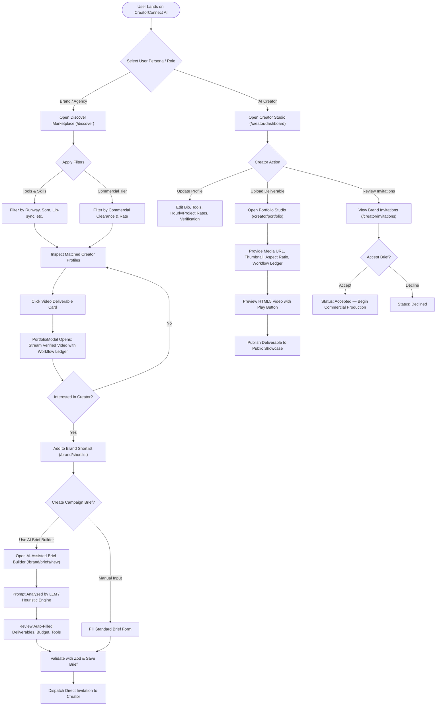
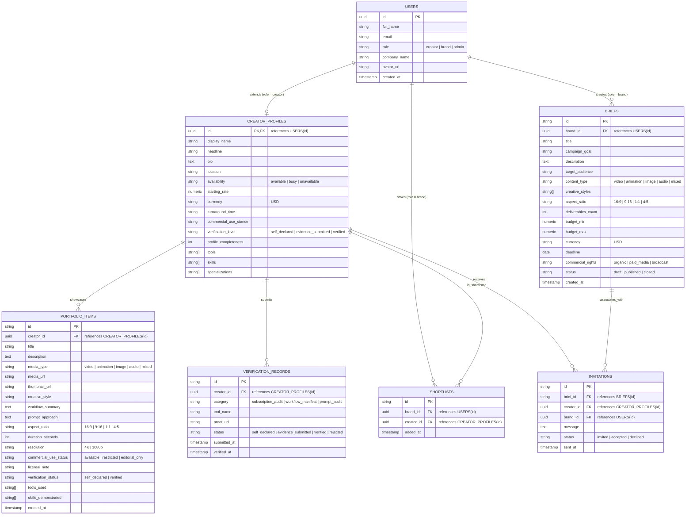

# CreatorConnect AI — Commercial AI Content Creator Marketplace
> **The Trust & Discovery Platform Connecting Frontier AI Filmmakers with Commercial Brands**

Built for **HacXLerate 2026 Round 1 | Kampus.VC Challenge**

[](https://nextjs.org/)
[](https://react.dev/)
[](https://www.typescriptlang.org/)
[](https://tailwindcss.com/)
[](https://zod.dev/)

---

## 1. Project Overview

### 1.1 Purpose
General freelance platforms (such as Upwork, Fiverr, and Behance) treat generative AI like traditional graphic design. They fail to audit AI generation engines, verify model subscription tiers, capture prompt ledgers, or validate copyright and commercial licensing. 

**CreatorConnect AI** is a specialized commercial marketplace designed specifically for the generative AI era. It bridges the trust gap between enterprise brands and AI content creators by enforcing documented production pipelines (e.g. Runway Gen-3, Midjourney v6, OpenAI Sora, ComfyUI, ElevenLabs) with clear commercial rights disclosures and verifiable workflow manifests.

### 1.2 Target User Roles

| Role | Core Needs & Platform Capabilities |
| :--- | :--- |
| **AI Content Creators** | • Build verified AI creator profiles with toolstacks, turnaround times, and pricing.<br>• Showcase portfolio pieces with workflow manifests, aspect ratios, and seed tokens.<br>• Upload and play HTML5 video deliverables with instant local/CDN playback.<br>• Submit evidence for tier verifications (Self-Declared, Evidence-Submitted, Verified).<br>• Receive, review, and accept/decline direct campaign brief invitations. |
| **Brands & Creative Agencies** | • Search and discover creators using multi-dimensional facet filtering (AND across categories, OR within).<br>• Inspect portfolio deliverables with interactive HTML5 video playback, frame specs, and tool history.<br>• Shortlist top creators and manage candidate rosters.<br>• Author structured creative briefs with explicit commercial usage rights.<br>• Utilize the **AI-Assisted Brief Builder** to translate rough ideas into structured production briefs.<br>• Dispatch direct brief invitations to shortlisted creators. |

---

## 2. High-Level System Architecture

The following diagram illustrates the four-tier architecture of CreatorConnect AI, detailing request flows across Presentation, Application, Data, and External Service boundaries.

```mermaid
flowchart TD
    %% Presentation Layer
    subgraph Presentation["1. Presentation Layer (Next.js 16 App Router)"]
        UI_Home["Landing & Spotlight Showcase<br/>(/)"]
        UI_Auth["Persona Switcher & Auth<br/>(/login, /signup)"]
        UI_Discover["Creator Discovery Engine<br/>(/discover)"]
        UI_Profile["Creator Profile & Portfolio<br/>(/creators/[id])"]
        UI_Modal["Interactive HTML5 Video Player<br/>(PortfolioModal)"]
        UI_BriefNew["AI-Assisted Brief Builder<br/>(/brand/briefs/new)"]
        UI_BrandDash["Brand Dashboard & Shortlist<br/>(/brand/dashboard, /brand/shortlist)"]
        UI_CreatorDash["Creator Studio & Uploads<br/>(/creator/dashboard, /creator/portfolio)"]
    end

    %% Application Layer
    subgraph Application["2. Application & API Layer (Next.js Server & Client Logic)"]
        AUTH_SVC["Auth & Role Context<br/>(auth-context.tsx)"]
        STORE_SVC["Reactive Store & Sanitize Engine<br/>(store.ts)"]
        VAL_SVC["Schema Validation Engine<br/>(validations.ts - Zod)"]
        FILTER_SVC["Multi-Category Facet Engine<br/>(Category AND / Tag OR)"]
        API_BRIEF["AI Brief Generator API<br/>(/api/generate-brief)"]
        API_VIDEO["Video Health & Async API<br/>(/api/video-status)"]
    end

    %% Data Layer
    subgraph DataTier["3. Data Persistence Tier"]
        subgraph LocalTier["Client / Local Tier (Active Dev & Demo)"]
            LS_AUTH["Auth Storage<br/>(cc_ai_auth_user_v1)"]
            LS_DATA["Marketplace Store<br/>(cc_ai_creators_v2, cc_ai_briefs_v1)"]
            SEED_DATA["Seed Data Engine<br/>(20+ Audited Creators & Briefs)"]
            LOCAL_MEDIA["Static Media Storage<br/>(public/videos/*.mp4)"]
        end
        subgraph PostgresTier["Production Relational DB (Supabase Migration)"]
        PG_PROFILES["Profiles & Creators Table"]
        PG_PORTFOLIO["Portfolio Deliverables Table"]
        PG_BRIEFS["Creative Briefs Table"]
        PG_INVITES["Shortlists & Invitations Table"]
        PG_VERIFY["Verifications & Audits Table"]
        PG_RLS["Row Level Security Policies"]
        end
    end

    %% External Services
    subgraph External["4. External Services & Cloud APIs"]
        EXT_LLM["OpenAI / LLM API<br/>(gpt-4o-mini / Semantic Fallback)"]
        EXT_STORAGE["Supabase Cloud / S3 Bucket<br/>(Planned Production Media)"]
    end

    %% Connections
    UI_Home --> STORE_SVC
    UI_Discover --> FILTER_SVC
    UI_Discover --> UI_Modal
    UI_Profile --> UI_Modal
    UI_Modal --> API_VIDEO
    UI_CreatorDash --> VAL_SVC
    VAL_SVC --> STORE_SVC
    UI_BriefNew --> API_BRIEF
    API_BRIEF --> EXT_LLM
    UI_Auth --> AUTH_SVC
    AUTH_SVC --> LS_AUTH

    FILTER_SVC --> STORE_SVC
    STORE_SVC --> LS_DATA
    STORE_SVC -.-> SEED_DATA
    API_VIDEO --> LOCAL_MEDIA
    LOCAL_MEDIA --> UI_Modal

    STORE_SVC -. "Production Sync" .-> PG_PROFILES
    STORE_SVC -. "Production Sync" .-> PG_PORTFOLIO
    STORE_SVC -. "Production Sync" .-> PG_BRIEFS
    STORE_SVC -. "Production Sync" .-> PG_INVITES
    STORE_SVC -. "Production Sync" .-> PG_VERIFY
```



---

## 3. End-to-End User Workflow

The platform provides dedicated, role-aware flows for both Creators and Brands with interactive branching.



---

## 4. Database Relationship Diagram (Logical Data Model)

Below is the logical Entity-Relationship (ER) model implemented in the system. The production DDL is provided in `supabase/migrations/001_initial_schema.sql` and mapped into client-side stores via TypeScript interfaces in `src/types/index.ts`.



---

## 5. Main Platform Modules

### 5.1 User Authentication & Role Switching
- **Purpose**: Manages authenticated sessions and role-based permissions (`brand`, `creator`, `admin`, `guest`).
- **Input**: User credentials, demo persona selector triggers (`Apex Athletics Studio` or `Elena Rostova`).
- **Output**: Reactive `user` profile, `role` claim, and persistence tokens.
- **Responsibilities**:
  - Encapsulated in [`src/lib/auth-context.tsx`](file:///c:/Users/balab/OneDrive/Desktop/Ai%20content%20creator%20marketplace/src/lib/auth-context.tsx).
  - Supplies instant role swapping in the Navbar for frictionless judging and demonstration.
  - Guard access to Brand-only actions (shortlisting, creating briefs) and Creator-only actions (portfolio publishing, profile edits).

### 5.2 Creator Profile Management
- **Purpose**: Maintains audited profiles of generative AI creators.
- **Input**: Creator bio, starting rates, availability, tool selections, and turnaround timelines.
- **Output**: Public creator showcase profiles and profile completeness scores (0–100%).
- **Responsibilities**:
  - Implemented in [`src/app/creators/[id]/page.tsx`](file:///c:/Users/balab/OneDrive/Desktop/Ai%20content%20creator%20marketplace/src/app/creators/[id]/page.tsx) and [`src/app/creator/profile/page.tsx`](file:///c:/Users/balab/OneDrive/Desktop/Ai%20content%20creator%20marketplace/src/app/creator/profile/page.tsx).
  - Normalizes AI tools (Runway, Sora, Kling, Midjourney) and production skills.
  - Computes dynamic profile completeness based on verified assets and specs.

### 5.3 AI Portfolio & HTML5 Video Playback
- **Purpose**: Delivers verifiable proof of generative craft, workflow ledgers, and video streaming.
- **Input**: Local video streams (`/videos/*.mp4`) or remote video streams, thumbnail posters, resolution specs, prompt notes, and pipeline summaries.
- **Output**: Interactive video cards with functional play buttons and the [`PortfolioModal`](file:///c:/Users/balab/OneDrive/Desktop/Ai%20content%20creator%20marketplace/src/components/PortfolioModal.tsx) modal player.
- **Responsibilities**:
  - HTML5 `<video controls playsInline autoPlay>` with byte-range streaming support (HTTP 206).
  - Browser autoplay policy handling (automatic fallback to muted autoplay + one-click unmute badge).
  - Active error recovery, buffering state spinners, and local verified fallbacks.
  - Asynchronous generation polling indicator for in-progress AI renders.

### 5.4 Creator Discovery & Multi-Category Filtering
- **Purpose**: Enables brands to find exact AI specialists without hallucinations or opaque algorithms.
- **Input**: Multi-select filter arrays (Tools, Skills, Formats, Verification, Availability, Price ranges) and keyword search terms.
- **Output**: Deterministically filtered creator lists with active filter chips and sorting.
- **Responsibilities**:
  - Implemented in [`src/app/discover/page.tsx`](file:///c:/Users/balab/OneDrive/Desktop/Ai%20content%20creator%20marketplace/src/app/discover/page.tsx) and [`src/components/FilterSidebar.tsx`](file:///c:/Users/balab/OneDrive/Desktop/Ai%20content%20creator%20marketplace/src/components/FilterSidebar.tsx).
  - Strict logic: **AND across categories** (Tool AND Skill AND Verification) with **OR within categories** (Runway OR Sora).
  - Full-text search over creator display names, biographies, and portfolio workflow strings.

### 5.5 Creative Brief Management
- **Purpose**: Enables brands to define structured commercial briefs with clear requirements.
- **Input**: Campaign goals, target audience, deliverables count, budget ranges, deadlines, and commercial rights tiers (organic, paid media, broadcast).
- **Output**: Persisted creative briefs with invitation dispatching to creators.
- **Responsibilities**:
  - Implemented in [`src/app/brand/briefs/new/page.tsx`](file:///c:/Users/balab/OneDrive/Desktop/Ai%20content%20creator%20marketplace/src/app/brand/briefs/new/page.tsx) and [`src/components/BriefDetailClient.tsx`](file:///c:/Users/balab/OneDrive/Desktop/Ai%20content%20creator%20marketplace/src/components/BriefDetailClient.tsx).
  - Enforces Zod validation against ambiguous specifications before publishing.

### 5.6 AI-Assisted Brief Builder
- **Purpose**: Transforms unstructured natural language ideas into complete, production-ready creative briefs.
- **Input**: Plain-text creative prompt (e.g. *"I need a 15s futuristic neon energy drink teaser for TikTok"*).
- **Output**: Structured JSON specifying title, platform targets, recommended AI engines, aspect ratio, styles, and creative direction.
- **Responsibilities**:
  - Implemented in [`src/app/api/generate-brief/route.ts`](file:///c:/Users/balab/OneDrive/Desktop/Ai%20content%20creator%20marketplace/src/app/api/generate-brief/route.ts).
  - Dual architecture: Uses server-side OpenAI LLM (`gpt-4o-mini`) when API keys are configured, and seamlessly falls back to a high-precision deterministic heuristic parser if keys are absent or network requests time out.

### 5.7 Creator Verification & Commercial Rights
- **Purpose**: Establishes transparent commercial clearance and skill authenticity tiers.
- **Input**: Verification evidence (enterprise license proof, prompt history, project invoices).
- **Output**: Verification badges (`self_declared`, `evidence_submitted`, `verified`) rendered across creator cards and modals.
- **Responsibilities**:
  - Implemented in [`src/components/VerificationBadge.tsx`](file:///c:/Users/balab/OneDrive/Desktop/Ai%20content%20creator%20marketplace/src/components/VerificationBadge.tsx).
  - Transparent disclosure of commercial usage stance and training data clearances.

### 5.8 Database & Media Storage Subsystem
- **Purpose**: Provides resilient persistence during development and ready-to-deploy schema for production.
- **Input**: CRUD requests for creators, briefs, shortlists, invitations, and portfolio deliverables.
- **Output**: Persisted records with schema guarantees and streamed video bytes.
- **Responsibilities**:
  - Client tier: LocalStorage-backed reactive cache (`store.ts`) with automatic schema migration and sanitization.
  - Server tier: Next.js static asset server providing `/videos/*.mp4` range-requests.
  - Production tier: PostgreSQL schema with Row-Level Security (RLS) in `supabase/migrations/001_initial_schema.sql`.

---

## 6. Actual Technology Stack

| Category | Technology Used | Implementation Status | Notes |
| :--- | :--- | :--- | :--- |
| **Frontend Framework** | **Next.js 16.4.0 (App Router)** | **Implemented** | Turbopack enabled, Partial Prefetching, React 19.3.0 |
| **Language** | **TypeScript 5.x** | **Implemented** | Strict typing across components, models, and API routes |
| **Styling & Design** | **Tailwind CSS v4** | **Implemented** | Modern dark-mode palette (Slate-950/900, Indigo, Violet, Cyan) |
| **Icons & UI Assets** | **Lucide React (v1.55.0)** | **Implemented** | Clean iconography across cards, players, and dashboards |
| **Schema Validation** | **Zod (v4.6.6)** | **Implemented** | Enforces input contracts on briefs, profiles, and media paths |
| **Application State** | **React Context + LocalStorage** | **Implemented** | Immediate demo persistence with zero cloud account friction |
| **API Endpoints** | **Next.js Route Handlers** | **Implemented** | `/api/generate-brief`, `/api/video-status` |
| **Video Playback** | **HTML5 `<video>` Engine** | **Implemented** | Full controls, playsInline, autoPlay fallback, error recovery |
| **Relational Database** | **PostgreSQL (Supabase)** | **Migration Ready** | Complete DDL in `supabase/migrations/001_initial_schema.sql` |
| **Media Storage** | **Local Next.js Asset Streaming** | **Implemented** | High-performance MP4 files in `public/videos/` with HTTP 206 |
| **Cloud Storage** | **Supabase Storage / AWS S3** | *Planned (Production)* | S3-compatible cloud bucket integration |
| **AI LLM Integration** | **OpenAI API (`gpt-4o-mini`)** | **Implemented (Hybrid)** | Cloud LLM with automatic semantic heuristic fallback |
| **Testing Framework** | **Vitest (v5.0.3) & Vite (v8.3.4)** | **Configured** | Test scripts in `package.json` |
| **Deployment Platform**| **Vercel / Node.js on Windows** | **Implemented** | Deployed locally on Windows; ready for Vercel 1-click deploy |

---

## 7. Data Flow & Security Architecture

### 7.1 Data Movement Pipelines
1. **Creator & Deliverable Pipeline**:
   - Creator enters deliverable specifications $\rightarrow$ Input validated by `portfolioItemSchema` (Zod) $\rightarrow$ Persisted to store $\rightarrow$ Video stream validated via `/api/video-status` $\rightarrow$ Rendered on public showcase with HTML5 player.
2. **Search & Filter Pipeline**:
   - User toggles facets in `FilterSidebar` $\rightarrow$ State updated in URL query string $\rightarrow$ Deterministic filter engine applies AND/OR logic over in-memory index $\rightarrow$ Rendered with zero network latency.
3. **AI Brief Generation Pipeline**:
   - Brand submits creative prompt $\rightarrow$ Request routed to `/api/generate-brief` $\rightarrow$ Evaluated against server-side API key $\rightarrow$ Structured JSON returned and auto-populates the brief form $\rightarrow$ Brand reviews, edits, and finalizes.

### 7.2 Security & Compliance Architecture
- **Role-Based Access Control (RBAC)**: Enforced through `useAuth()` context. Unauthenticated or wrong-role requests cannot submit briefs or modify creator deliverables.
- **Server-Side API Key Protection**: AI credentials (`LLM_API_KEY`, `OPENAI_API_KEY`) remain strictly on the server within Route Handlers and are never exposed to browser bundles.
- **Input Sanitization**: All user inputs (brief descriptions, rates, URLs) are validated against strict Zod schemas preventing script injection.
- **Video Stream Validation & MIME Checking**: The `/api/video-status` route verifies that incoming streams are genuine `video/mp4` streams and flags HTTP 403 access denials.
- **Row-Level Security (RLS)**: The production PostgreSQL migration defines strict RLS policies ensuring creators can only update their own portfolios and brands can only modify their own briefs.
- **Commercial Rights Transparency**: Every portfolio item and brief enforces explicit declaration of commercial usage rights (Organic, Paid Digital, Broadcast) to avoid copyright ambiguity.

---

## 8. Alignment with Evaluation Criteria

| Evaluation Criterion | Weight | Supporting Architectural Components |
| :--- | :---: | :--- |
| **Creator Profiles & AI Portfolios** | **30%** | • **Documented Pipeline Ledger**: Detailed prompt approaches, iteration counts, and upscale nodes.<br>• **HTML5 Video Playback**: Fully functional play buttons, autoPlay with muted fallback, and error handling in `PortfolioModal`.<br>• **Specification Tags**: Aspect ratios (16:9, 9:16), 4K resolutions, and tool taxonomy chips. |
| **Discovery & Filtering** | **25%** | • **Zero-Hallucination Search**: Multi-category deterministic filtering (AND across categories, OR within).<br>• **Audited Tool Catalog**: Filtering by Runway, Sora, Kling, ComfyUI, Midjourney, and ElevenLabs.<br>• **Active Filter Chips**: Instant reset, category counters, and dynamic URL state synchronization. |
| **Brief Definition** | **20%** | • **Structured Brief Model**: Target audience, deliverables count, budget ranges, and commercial rights.<br>• **AI-Assisted Brief Builder**: Generates production briefs from natural language using `/api/generate-brief`.<br>• **Direct Creator Invitations**: Seamless dispatch of published briefs to shortlisted creator profiles. |
| **User Experience** | **15%** | • **Curated Dark Mode Theme**: Sleek glassmorphism with Tailwind CSS v4 and responsive layouts.<br>• **Persona Switcher**: One-click switching between Brand, Creator, and Guest in the Navbar.<br>• **Micro-Interactions**: Hover scales, loading indicators, and informative stream status badges. |
| **Presentation & Demo Reliability** | **10%** | • **Zero-Dependency Local Streaming**: High-quality local video assets in `public/videos/` eliminating third-party CDN downtime.<br>• **Dual Persistence**: Instant offline LocalStorage cache with a production-ready PostgreSQL migration.<br>• **Clean Build**: 100% TypeScript type safety with all routes pre-rendering cleanly. |

---

## 9. Getting Started & Running Locally

### Prerequisites
- Node.js v18.17+ or v20+ (Node v22.14.0 verified)
- Windows PowerShell, macOS Terminal, or Linux Bash

### Step 1: Install Dependencies
```bash
npm install
```

### Step 2: Start the Development Server
On Windows PowerShell:
```powershell
$env:Path = "$env:LOCALAPPDATA\Programs\nodejs;" + $env:Path
npm run dev
```

On macOS / Linux:
```bash
npm run dev
```

### Step 3: Open in Browser
Navigate to **[http://localhost:3000](http://localhost:3000)**.

### Step 4: Persona Testing
- Use the **Persona dropdown in the top-right Navbar** to toggle between **Brand** (`Apex Athletics`) and **Creator** (`Elena Rostova`).
- Test video playback on the Homepage, Discover page, and Creator Studio.
- Test the AI-Assisted Brief Builder at `/brand/briefs/new`.

### Step 5: Production Build Verification
```bash
npm run build
npm start
```
